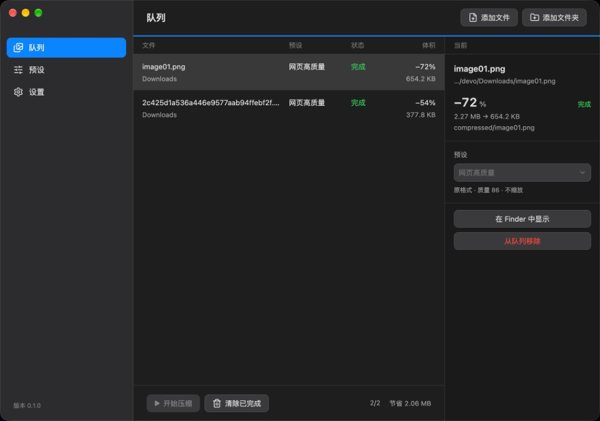
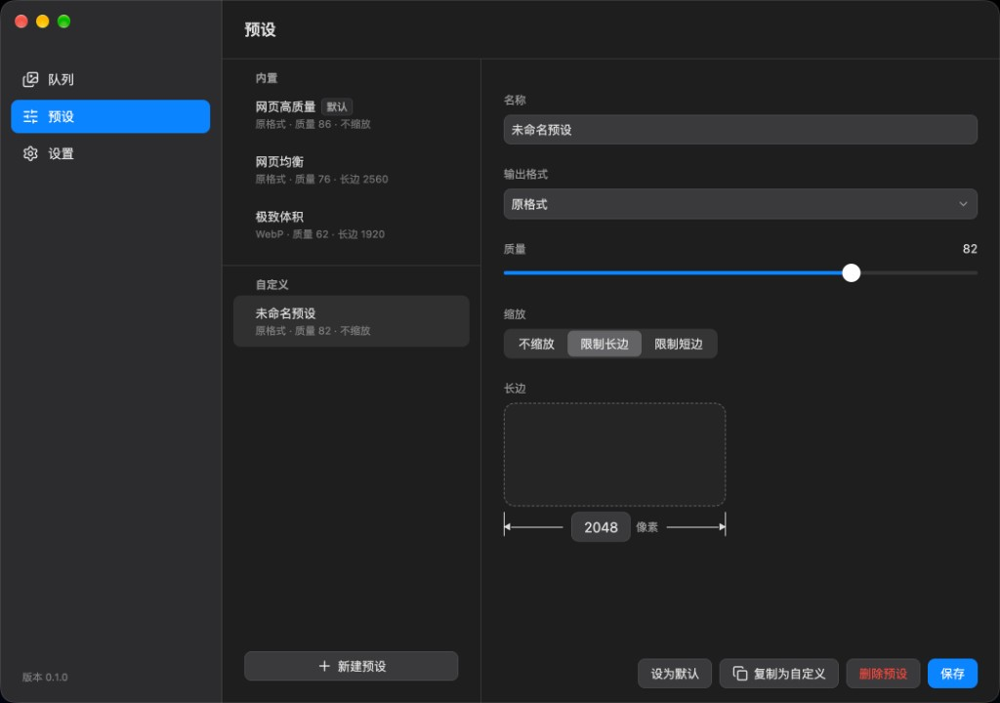

<p align="center">
  
</p>

<h1 align="center">图拉Tula</h1>

<p align="center">
  macOS 桌面端的本地图片压缩工具。用队列批量处理 JPEG、PNG、WebP 和 GIF，编码在本机完成，原图不会上传。
</p>

<p align="center">
  <a href="package.json"></a>
  
  
  
  <a href="LICENSE"></a>
</p>

界面为简体中文。只提供 macOS，安装包未签名、未公证。

<p align="center">
  
</p>

## 特性

- 文件、文件夹或拖放加入队列，按预设批量压缩
- 输出到原图旁的 `compressed` 目录，不覆盖原图；重名时追加序号
- 输出可保持原格式，或转为 JPEG、WebP、PNG
- 可限制长边或短边，只缩小、不放大
- 内置预设只读，自定义预设可保存并设为默认
- 外观跟随系统，或固定为亮色、暗色
- 同时压缩的张数可调，范围 1–10

## 安装

从发布产物中选择与本机芯片相符的安装包：

| 文件                       | 架构       |
| -------------------------- | ---------- |
| `图拉Tula-0.1.0-arm64.dmg` | Apple 芯片 |
| `图拉Tula-0.1.0.dmg`       | Intel      |

安装包没有 Apple 签名。访达中右键安装包或应用，选择「打开」。

## 行为

加入文件夹时跳过隐藏文件，以及名为 `compressed`、`node_modules` 的目录，最深 8 层。队列上限 2000 张。

质量为 30–100。限制边长的范围是 1–16384 像素。PNG 质量达到 90 及以上时按无损编码。压缩结果不保留原图元数据。动图转为 JPEG 或 PNG 时得到静图；输出为 GIF 或 WebP 时保留动画。

暂停后不再开始新任务，已经开始的一张会完成。自定义预设最多 50 个。新加入队列的图片使用当前默认预设。

并行张数表示同时处理几张图片，不是 CPU 线程数。默认 2 张。

## 内置预设

内置预设不能直接修改。需要不同参数时，复制为自定义预设后保存。

<p align="center">
  
</p>

| 名称       | 格式   | 质量 | 缩放      |
| ---------- | ------ | ---- | --------- |
| 网页高质量 | 原格式 | 86   | 不缩放    |
| 网页均衡   | 原格式 | 76   | 长边 2560 |
| 极致体积   | WebP   | 62   | 长边 1920 |

## 快捷键

| 操作       | 快捷键  |
| ---------- | ------- |
| 添加文件   | ⌘O      |
| 添加文件夹 | ⇧⌘O     |
| 开始压缩   | ⌘↩      |
| 暂停或继续 | ⌘.      |
| 设置       | ⌘,      |
| 全选队列   | ⌘A      |
| 扩展选择   | ⇧↑ / ⇧↓ |
| 移除所选   | ⌫       |

焦点在输入框内时，⌘A 选中框内文字。

## 从源码构建

`develop` 用来做日常开发，`main` 只放准备发布的版本。功能在 `develop` 上完成后，合并进 `main`，再打 `v*` 标签。推送到这两个分支会跑测试和类型检查。打上标签后，GitHub 会编译 Apple 芯片和 Intel 的 dmg，并挂到对应的 Release。

需要 macOS、Node.js 和 pnpm 10。

```bash
pnpm install
pnpm dev
```

```bash
pnpm test
pnpm typecheck
pnpm dist
```

`pnpm dist` 在 `release/` 生成上面列出的两个 dmg。

| 目录              | 内容                                          |
| ----------------- | --------------------------------------------- |
| `src/main`        | 窗口、菜单、配置和任务调度                    |
| `src/preload`     | 渲染进程与主进程之间的桥                      |
| `src/renderer`    | React 界面                                    |
| `src/compression` | 基于 sharp 的压缩实现，运行在 Utility Process |
| `src/shared`      | 预设、校验和两端共用的类型                    |

## 开发计划

- [x] 本地队列压缩，支持 JPEG、PNG、WebP、GIF
- [x] 拖放、添加文件和添加文件夹
- [x] 多选、快捷键，以及顶部提示
- [x] 内置预设、自定义预设、设为默认、显式保存
- [x] 原格式或转为 JPEG、WebP、PNG；限制长边或短边
- [x] 结果写入旁边的 `compressed` 目录，不覆盖原图
- [x] 外观跟随系统、亮色或暗色；并行张数 1–10
- [ ] Windows 版本
- [ ] 其他更多功能...

压缩继续在本机完成，不加入上传或自动更新。

## 许可证

[MIT License](LICENSE)。Copyright (c) 2026 Devo。
